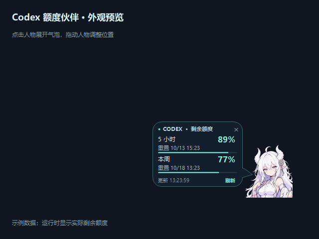

# Codex Quota Companion · Codex 额度伙伴

给 Windows Codex 桌面客户端加一个可拖动的头像。点击头像，就能看到贴在人物旁边的额度气泡：**剩余百分比、5 小时／本周额度，以及各自的重置日期和时间**。

这是当前人物头像版本，保留客户端右下角吸附、随窗口缩放、整体拖动和半透明漫画气泡。



*上图使用示例额度。实际运行显示你的账号返回的数据。*

## 使用体验

- 默认放在客户端右下角，切换会话后仍显示。
- 按住人物拖动；人物和气泡一起移动，方向和间距保持一致。
- 放大、缩小和移动客户端时，人物随之调整；整个组合限制在客户端内部。
- 点击人物展开／收起，点击外部空白收起，气泡内也有关闭和刷新按钮。气泡会在 20 秒后自动收起。
- 气泡使用 80% 不透明度，显示当地时间的重置日期和时刻。
- 最小化客户端时隐藏并暂停查询，恢复后更新；正常关闭客户端时一起退出。

它是**第三方 Windows 桌面伴随组件**，带有 Codex 插件入口。显示层使用客户端所属的原生窗口；没有修改客户端文件，也不是官方内置界面扩展。

## 最简单的使用方法

1. 在 [Releases](https://github.com/tanbaobao813-crypto/codex-quota-companion/releases) 下载 `codex-quota-companion-v0.1.0-windows.zip`。
2. 完整解压到自己的文件夹。
3. 双击 **启动客户端和额度伙伴.cmd**，一起打开客户端与额度伙伴。可以给这个文件创建桌面快捷方式。

如果客户端已经打开，也可以直接运行 `plugins/codex-quota-companion/bin/CodexQuotaWidget.exe`。未找到客户端时，组件只等待启动窗口一小段时间，不会永久驻留。

停止组件可双击 **关闭额度伙伴.cmd**；客户端本身继续运行。

**环境：** Windows 10 1607 或更新版本、已安装并登录的 Codex 桌面客户端、.NET Framework 4.x。Windows 11 通常已经具备运行环境。独立 EXE 不需要 Node.js。当前主要验证环境为 Windows 11；可执行文件尚未代码签名。

## 作为 Codex 插件安装

插件包含 3 个本地 MCP 工具和一个 `SessionStart` 启动钩子。此方式额外需要 **Node.js 18+** 在 PATH 中，以及支持插件和钩子的 Codex 版本。

在 Codex CLI 中执行：

```powershell
codex plugin marketplace add tanbaobao813-crypto/codex-quota-companion
codex plugin add codex-quota-companion@codex-quota-companion
codex plugin list --json
```

按客户端提示检查并信任插件钩子，然后开始新会话。启用且获得信任的 `SessionStart` 钩子会启动额度伙伴；**安装本身不等于 Windows 开机或客户端进程启动时自动运行**。希望每次打开客户端都出现，请使用上面的启动入口。

可让 Codex 执行：

- “启动额度伙伴” → `quota_companion_start`
- “查看额度伙伴状态” → `quota_companion_status`
- “关闭额度伙伴” → `quota_companion_stop`

额度刷新由组件自行处理，无需持续向模型发送消息。MCP 状态工具只读取已经显示的状态，不会额外请求额度。

如果已有旧版本伙伴运行，启动会复用它，避免出现两个人物；要切换版本，请先关闭旧组件，再启动新版本。

此仓库通过 GitHub 手动分发，**未上架 OpenAI 官方公共插件目录**。钩子支持和用户信任规则见 [官方插件文档](https://developers.openai.com/plugins/build/plugins) 与 [官方钩子文档](https://learn.chatgpt.com/docs/hooks)。

## 数据与权限

- 使用已安装客户端附带的 Codex `app-server`，通过 `account/rateLimits/read` 读取登录账号的额度。一次正常刷新包含协议初始化与一次额度读取；连接失败时最多重试一次，不分别查询两个额度窗口。
- 没有读取设置页面的 DOM，也没有接管客户端内部连接。数据来自同类账号额度接口；客户端与组件的查询时间不同，短时间内可能出现显示差异。
- 正常约 30 秒刷新；活动触发的刷新至少间隔 10 秒。失败后保留上次数据并显示“暂未更新”，延后重试；不会猜测额度已恢复。
- 不上传账号、聊天或额度数据到本项目服务器；不复制登录凭据到插件目录。请求会访问 OpenAI 服务并使用现有 Codex 登录。
- 仅气泡打开时安装鼠标点击监听，用来实现点击外部关闭。事件原样传递，不监听键盘，不保存鼠标坐标；拖动时暂停，收起时释放。
- 不添加 Windows 服务、计划任务或开机启动项。
- 人物位置与简短错误诊断默认保存在 `%LOCALAPPDATA%\CodexQuotaCompanion`；插件启动时优先使用宿主提供的 `PLUGIN_DATA`／`CLAUDE_PLUGIN_DATA`。卸载插件不会删除这些个人设置。

客户端版本变化可能影响窗口识别、启动入口和额度接口。组件包含检测到更新重启意图后的重新挂接机制，但本发布包**尚未验证一次真实客户端自动更新全过程**。

## 构建与验证

```powershell
powershell -NoProfile -ExecutionPolicy Bypass -File scripts/build.ps1
node --test tests/mcp.test.mjs
powershell -NoProfile -ExecutionPolicy Bypass -File scripts/check-native.ps1
powershell -NoProfile -ExecutionPolicy Bypass -File scripts/package.ps1
```

构建使用 Windows 自带的 .NET Framework 编译器，无 NuGet／npm 依赖下载。原生检查使用独立的示例窗口和模拟额度，不查询账号；检查期间请避免点击该窗口外部，否则“点击外部收起”的正常行为会打断检查。

发布前验证：7 项 MCP／协议检查、6 项额度解析检查、48 项原生窗口检查；另使用空白 Codex 配置验证插件安装，并在含中文和空格的新解压路径验证运行。它们不替代其他电脑上的实际登录、真实更新或手动桌面交互验收。

## 卸载

```powershell
codex plugin remove codex-quota-companion@codex-quota-companion
codex plugin marketplace remove codex-quota-companion
```

先关闭运行中的组件；如果使用独立 ZIP，删除解压文件夹和自己创建的快捷方式即可。可选删除个人数据目录。项目不改写原来的客户端快捷方式。

## 授权

代码采用 [MIT](LICENSE)。当前人物图片由发布者提供并选择随包发布，**不属于代码 MIT 授权**；原作者和再分发授权材料尚未提供。图片来源与使用说明见 [图片声明](plugins/codex-quota-companion/assets/NOTICE.md)。本项目不声称拥有该人物的原创版权。
